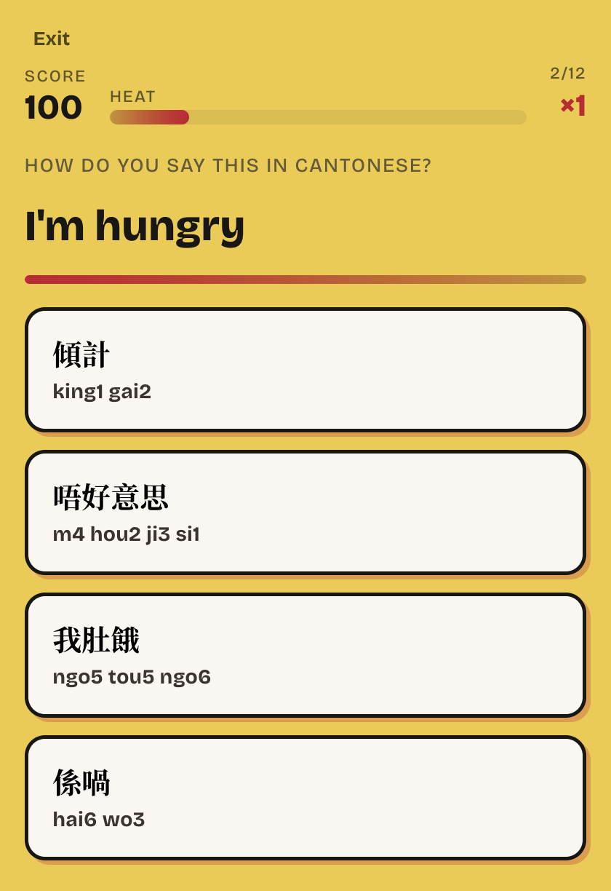
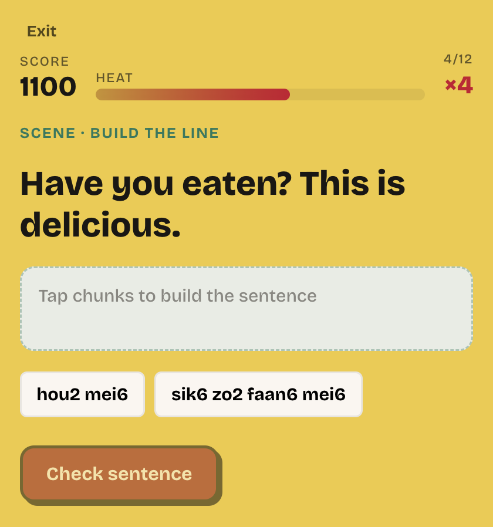

# Jyut Heat

A short browser game for everyday Cantonese. You get an English prompt, you pick the Jyutping, and every few rounds you build a sentence out of romanized chunks. The characters appear when you answer, so you can play before you can read them.

The word list leans toward family, food, home, and talking with in-laws — the Cantonese you actually want on the tip of your tongue.

**Play it:** [liyanasatar.github.io/jyut-heat](https://liyanasatar.github.io/jyut-heat/)

<p align="center">
  
  
  
</p>

## Play a round

1. **Start Heat.** Twelve prompts. A bar runs down on each one. Answer in the first half of the bar and you get a speed bonus.
2. Pick the line. Each choice shows the characters and the Jyutping, like `我肚餓` / `ngo5 tou5 ngo6`. The number on each syllable is the tone.
3. A correct answer builds a combo, up to ×5. A miss shows the line you wanted and resets the combo. Misses are saved under **Need to Learn**.
4. Every fourth prompt, a **scene** breaks in. You tap Jyutping chunks into a sentence, like “Have you eaten? This is delicious.”
5. At the end you get a score, your best, and how many heats are left until the next level.

Finish 5 heats to unlock Intermediate, 15 to unlock Advanced. Two correct reviews in a row clear a phrase from Need to Learn. Streak, best score, and review all stay in the browser — there is no account.

## Run it

You need [Node.js](https://nodejs.org).

```bash
npm install
npm run dev
```

Open the address Vite prints, usually `http://localhost:5173`.

On your phone, same Wi‑Fi:

```bash
npm run dev:phone
```

Open the **Network** address Vite prints. Leave the terminal running while you play.

| Command | What it does |
| --- | --- |
| `npm run dev` | Local play |
| `npm run dev:phone` | Same, reachable from your phone |
| `npm run build` | Typecheck and production build |
| `npm run preview` | Play the production build |

The same game is published at [liyanasatar.github.io/jyut-heat](https://liyanasatar.github.io/jyut-heat/). That copy updates whenever `main` changes.

## How it's built

It is one React app. No server, no database. A heat is a short state machine, and the phrase book is plain data.

```
Home
  └─ Heat run
       ├─ Pulse Match   (12 prompts)
       └─ Scene         (after every 4th prompt)
  └─ Results
  └─ Need to Learn
  └─ Levels
```

| Piece | File | What it owns |
| --- | --- | --- |
| The phrase book | `src/data/content.ts` | Phrases and scenes: English, characters, Jyutping, level, tags |
| The rules | `src/game/scoring.ts` | Points, combo, timer, how many heats unlock a level |
| The deck | `src/game/runEngine.ts` | Which 12 phrases you get, the three distractors, the scene |
| Memory | `src/game/progress.ts` | Best score, streak, review list, in `localStorage` |
| The screens | `src/pages/` | Home, the run, results, review, levels |
| The two games | `src/components/PulseMatch.tsx`, `SceneBuilder.tsx` | The tap targets |
| The look | `src/styles/tokens.css`, `public/hk-hero.png` | Color, type, the street on the home screen |

A match is worth `100 × combo`, plus 50 if you answer in the first half of the 6.5 second bar. Combo caps at ×5. A correct scene adds `150 × combo`. Getting one wrong puts that phrase on the review list.

The deck prefers your current level, phrases you have not seen recently, and the family / home / food tags. Distractors are other phrases that share a tag, so the wrong answers feel close.

## Make your own

The game loop does not care that the language is Cantonese. The phrase book does. To teach something else — another language, kitchen words, your own family — edit `src/data/content.ts` and leave the rest alone.

A phrase:

```ts
{
  id: 'b30',
  zh: '我肚餓',
  jyutping: 'ngo5 tou5 ngo6',
  en: "I'm hungry",
  level: 'beginner',
  tags: ['food', 'home'],
}
```

A scene is the same idea, plus the chunks in the order that makes the sentence:

```ts
{
  id: 's2',
  en: 'Have you eaten? This is delicious.',
  zh: '食咗飯未？好味。',
  jyutping: 'sik6 zo2 faan6 mei6 hou2 mei6',
  chunks: ['sik6 zo2 faan6 mei6', 'hou2 mei6'],
  level: 'beginner',
  tags: ['food', 'family'],
}
```

`chunks` must be the correct order. The game shuffles them.

Knobs, all in `src/game/scoring.ts`:

| Constant | Default | Effect |
| --- | --- | --- |
| `PULSE_MS` | 6500 | How long you have on a prompt |
| `MATCHES_PER_RUN` | 12 | Prompts per heat |
| `SCENE_EVERY_N` | 4 | How often a sentence round appears |
| `RUNS_UNLOCK` | 5, then 15 | Heats to open Intermediate and Advanced |

Swap the home illustration by replacing `public/hk-hero.png`. Earlier street sketches are in `public/hero-options/` if you want a different night.

## Stack

React 19, TypeScript, and Vite. Progress never leaves the browser.

## License

[MIT](LICENSE). Play it, fork it, aim it at another language.
